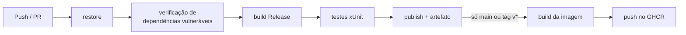

# Task API

[](https://github.com/juliabrpereira/task-project/actions/workflows/ci.yml)

API REST de gerenciamento de tarefas, construída como projeto final de DevOps.

**Objetivo:** demonstrar o ciclo completo de entrega de uma aplicação, do código à implantação: versionamento com GitHub Flow, testes automatizados, pipeline de CI/CD, imagem Docker publicada em registry, deploy reproduzível com Docker Compose, práticas de segurança e observabilidade.

## Autora

Julia ([juliabrpereira](https://github.com/juliabrpereira)). Projeto individual.

## Tecnologias

| Área | Tecnologia |
|---|---|
| Aplicação | .NET 10, ASP.NET Core Minimal API |
| Testes | xUnit, `Microsoft.AspNetCore.Mvc.Testing` (`WebApplicationFactory`) |
| Container | Docker (build em múltiplos estágios), Docker Compose |
| CI/CD | GitHub Actions |
| Registry | GitHub Container Registry (GHCR) |
| Segurança | Dependabot, CodeQL, `dotnet list package --vulnerable` |
| Observabilidade | ASP.NET Core Health Checks, `ILogger` |

## Pré-requisitos

| Ferramenta | Versão | Quando é necessária |
|---|---|---|
| [Git](https://git-scm.com/) | qualquer versão recente | Sempre |
| [Docker](https://docs.docker.com/get-docker/) com Docker Compose | 24+ | Para rodar com containers |
| [.NET SDK](https://dotnet.microsoft.com/download/dotnet/10.0) | 10.0 | Só para rodar ou testar sem Docker |

O projeto usa .NET 10 (`net10.0`), então o SDK do .NET 8 não serve.

## Como executar

### Com Docker Compose (recomendado)

Funciona igual em qualquer máquina com Docker, sem precisar do .NET instalado. A imagem é baixada do GHCR:

```
git clone https://github.com/juliabrpereira/task-project.git
cd task-project
cp .env.example .env
docker compose up -d
docker compose ps
```

No PowerShell, troque `cp` por `Copy-Item .env.example .env`. Para parar: `docker compose down`.

### Sem Docker

```
dotnet run --project src/TaskApi.Api
```

A API sobe em `http://localhost:5169`. Nos exemplos abaixo, troque a porta 8080 por 5169.

### Configuração de ambiente

Toda a configuração vem de variáveis de ambiente. O Compose lê o `.env` automaticamente. O [.env.example](.env.example) traz os valores padrão e não tem nenhum dado sensível. O `.env` fica fora do Git, então cada máquina pode ter seus próprios valores.

| Variável no `.env` | Padrão | Vira, no container | Função |
|---|---|---|---|
| `IMAGE_TAG` | `latest` | tag da imagem | Versão a implantar (`latest`, `v1.0.0`, `sha-<commit>`) |
| `HOST_PORT` | `8080` | porta publicada | Porta da máquina onde a API fica acessível |
| `APP_ENV` | `Production` | `ASPNETCORE_ENVIRONMENT` | Ambiente (`Development`, `Staging`, `Production`) |
| `LOG_LEVEL` | `Information` | `Logging__LogLevel__Default` | Nível mínimo de log |
| `HEALTH_MEMORY_LIMIT_MB` | `512` | `HealthChecks__MemoryLimitMB` | Limite de memória do health check |

Dentro do container, a API sempre escuta na porta 8080 (`ASPNETCORE_HTTP_PORTS`, definida no Dockerfile). Para mudar a porta de acesso, altere só `HOST_PORT`.

## Como usar a API

| Método | Rota | Descrição | Respostas |
|---|---|---|---|
| GET | `/health` | Verificação de saúde | 200, 503 |
| GET | `/tasks` | Lista as tarefas | 200 |
| GET | `/tasks/{id}` | Busca uma tarefa | 200, 404 |
| POST | `/tasks` | Cria uma tarefa | 201, 400 |
| PUT | `/tasks/{id}` | Atualiza uma tarefa | 200, 400, 404 |
| DELETE | `/tasks/{id}` | Remove uma tarefa | 204, 404 |

Regras de negócio:
- O título é obrigatório (não pode ser vazio nem só espaços) e tem no máximo 100 caracteres.
- Uma tarefa já concluída não pode ser concluída de novo.

As tarefas ficam em memória e se perdem quando a aplicação reinicia.

### Exemplos com curl

Os exemplos usam aspas simples, então funcionam no Bash (Git Bash, Linux, macOS), mas não no PowerShell.

```
curl http://localhost:8080/health

curl -X POST http://localhost:8080/tasks \
  -H "Content-Type: application/json" \
  -d '{"title":"Estudar DevOps","description":"Revisar o pipeline"}'

curl http://localhost:8080/tasks
curl http://localhost:8080/tasks/1

curl -X PUT http://localhost:8080/tasks/1 \
  -H "Content-Type: application/json" \
  -d '{"title":"Estudar DevOps","isCompleted":true}'

curl -X DELETE http://localhost:8080/tasks/1
```

Exemplo de erro de validação (título vazio → 400):

```
curl -X POST http://localhost:8080/tasks -H "Content-Type: application/json" -d '{"title":""}'
```

```json
{"type":"https://tools.ietf.org/html/rfc9110#section-15.5.1","title":"One or more validation errors occurred.","status":400,"errors":{"task":["O título é obrigatório."]}}
```

## Estratégia de branches: GitHub Flow

- O `main` está sempre pronto para implantar, e cada merge nele publica uma imagem nova.
- Cada mudança é feita num branch curto a partir do `main` (`feature/crud-tasks`, `feature/testes-automatizados`, `feature/dockerfile`, `feature/ci-pipeline`, `feature/compose-deploy`...).
- O branch vira um pull request. O CI roda build e testes, e o merge só acontece com o pipeline verde.
- As versões de release são marcadas com tags Git (`v1.0.0`), que geram imagens com a mesma tag.

**Por que GitHub Flow, e não Git Flow:** o projeto tem uma única desenvolvedora, uma única versão em produção e entrega contínua a cada merge. O GitHub Flow tem um único branch permanente e não precisa de `develop`, `release/*` nem `hotfix/*`, cuja manutenção só se paga em equipes maiores ou com várias versões em paralelo. A qualidade é garantida pelo CI em cada pull request, não por branches intermediários.

## Pipeline CI/CD

Definido em [.github/workflows/ci.yml](.github/workflows/ci.yml).



| Job | Quando roda | Etapas |
|---|---|---|
| `build-test` | Todo pull request, push no `main` e tag `v*` | `dotnet restore` → verificação de vulnerabilidades → `dotnet build` → `dotnet test` → `dotnet publish` → artefato `taskapi-publish` |
| `docker` | Push no `main` ou tag `v*`, só se `build-test` passar | login no GHCR → geração de tags → build e push da imagem |

## Testes automatizados

Rodam com `dotnet test`: 13 testes, ou 15 casos contando as variações do `[Theory]`.

**Unitários: regra de negócio** ([TaskRulesTests.cs](tests/TaskApi.Tests/TaskRulesTests.cs))

| Caso | Esperado |
|---|---|
| Criar com título válido | Sem erros |
| Criar com título vazio (`null`, `""`, `"   "`) | Erro "O título é obrigatório." |
| Criar com título acima de 100 caracteres | Erro |
| Concluir tarefa pendente | Sem erros |
| Concluir tarefa já concluída | Erro |

**Integração: endpoints com `WebApplicationFactory<Program>`** ([TasksEndpointsTests.cs](tests/TaskApi.Tests/TasksEndpointsTests.cs))

| Caso | Esperado |
|---|---|
| `GET /health` | 200, `Healthy` |
| `GET /health` com memória acima do limite | 503, `Unhealthy` |
| `GET /tasks` | 200 |
| `POST /tasks` com título válido | 201, tarefa no corpo e header `Location` |
| `POST /tasks` com título vazio | 400 |
| `GET /tasks/{id}` inexistente | 404 |
| `PUT` concluindo a mesma tarefa duas vezes | 200 e depois 400 |
| `DELETE /tasks/{id}` | 204, e depois o `GET` dá 404 |

## Artefato: imagem Docker

A imagem fica no GHCR: [ghcr.io/juliabrpereira/task-project](https://github.com/juliabrpereira/task-project/pkgs/container/task-project)

```
docker pull ghcr.io/juliabrpereira/task-project:latest
```

| Tag | Gerada quando | Uso |
|---|---|---|
| `sha-<commit>` | Todo push no `main` e toda tag | Identifica exatamente o commit de origem |
| `v1.0.0` | Push da tag Git `v1.0.0` | Versão de release, com o mesmo nome da tag do código |
| `latest` | Push no `main` | Última versão do `main` |

A imagem tem build em múltiplos estágios (o SDK fica fora da imagem final) e roda com o usuário sem privilégios `app`. O pipeline também guarda o resultado do `dotnet publish` como artefato `taskapi-publish` em cada execução.

## Deploy, atualização e rollback

A implantação é feita com Docker Compose, escolhendo a versão pela variável `IMAGE_TAG`:

| Operação | Comando |
|---|---|
| Deploy | `IMAGE_TAG=v1.0.0 docker compose up -d` |
| Atualização | `IMAGE_TAG=<nova> docker compose pull` e depois `IMAGE_TAG=<nova> docker compose up -d` |
| Rollback | `IMAGE_TAG=<anterior> docker compose up -d` |

Como cada versão é uma imagem imutável no GHCR, o rollback não exige recompilar nada. Os detalhes estão em [docs/DEPLOY.md](docs/DEPLOY.md).

## Segurança e observabilidade

**Segurança** (detalhes em [docs/SEGURANCA.md](docs/SEGURANCA.md)):
- O CI falha se algum pacote NuGet, direto ou transitivo, tiver vulnerabilidade conhecida.
- O Dependabot abre PRs semanais para pacotes NuGet, imagens Docker e GitHub Actions.
- O CodeQL faz análise estática do código C#.
- Nenhum segredo no repositório: o GHCR usa o `GITHUB_TOKEN` e o `.env` não é versionado.
- O workflow tem permissões mínimas (`contents: read`, mais `packages: write` só no job de publicação).
- A imagem roda com usuário não-root e tem build em múltiplos estágios.

**Observabilidade** (detalhes em [docs/OBSERVABILIDADE.md](docs/OBSERVABILIDADE.md)):
- `/health` usa os Health Checks do ASP.NET Core, com uma verificação de memória.
- O Compose tem um healthcheck que marca o container como `unhealthy` se o `/health` falhar.
- Logs estruturados com `ILogger`: Information (tarefa criada, atualizada ou removida), Warning (erro de validação, tarefa não encontrada) e Error (health check falhou).
- Para acompanhar os logs: `docker compose logs -f` ou `docker logs <container>`.

## Evidências

| Execução | Resultado | Explicação |
|---|---|---|
| [PR #5: execução do CI](https://github.com/juliabrpereira/task-project/actions/runs/45065443259) | ❌ Falha | O [PR #5](https://github.com/juliabrpereira/task-project/pull/5) trocou de propósito `IsNullOrWhiteSpace` por `IsNullOrEmpty` na validação do título, sem atualizar os testes. O job `build-test` falhou no passo `dotnet test`, porque o caso de título `"   "` deixou de ser rejeitado, e o job `docker` foi pulado. O PR foi fechado sem merge e nenhuma imagem com o defeito foi publicada. |
| [PR #6: execução do CI](https://github.com/juliabrpereira/task-project/actions/runs/45070843178) | ✅ Sucesso | Build, verificação e testes passaram no pull request do deploy com Compose. |
| [Merge no `main`](https://github.com/juliabrpereira/task-project/actions/runs/45070857230) | ✅ Sucesso | Depois do merge, o job `docker` publicou as imagens `latest` e `sha-<commit>` no GHCR. |
| [Tag `v1.0.0`](https://github.com/juliabrpereira/task-project/actions/runs/45070932794) | ✅ Sucesso | O push da tag publicou a imagem `v1.0.0`, ligando a versão do código à versão da imagem. |

## Estrutura do repositório

```
.github/
  workflows/ci.yml       pipeline de CI/CD
  dependabot.yml         atualizações automáticas de dependências
docs/
  DEPLOY.md              entrega, deploy, atualização e rollback
  SEGURANCA.md           práticas de DevSecOps
  OBSERVABILIDADE.md     health check, logs e demonstração de falha
src/TaskApi.Api/         API (Program.cs, Models, Rules, Data, Health)
tests/TaskApi.Tests/     testes unitários e de integração
Dockerfile               imagem em múltiplos estágios, usuário não-root
docker-compose.yml       deploy local a partir do GHCR
.env.example             modelo de configuração
```
